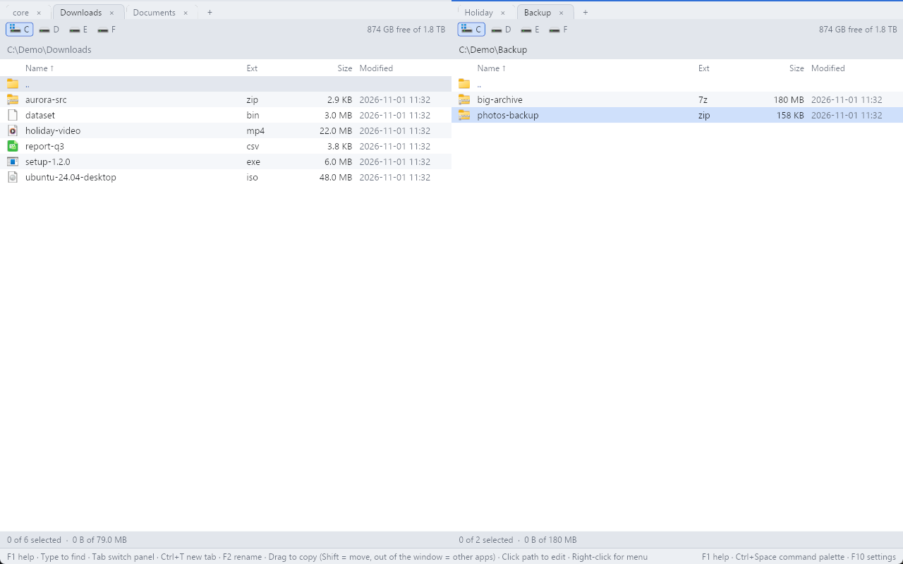

# RustCommander

An open-source Total Commander alternative that keeps TC's keyboard workflow
with a modern, minimalist look. Written in Rust with [iced](https://iced.rs).


## Features

**Panels**
- Dual panels with tabs per side, virtualised lists, sorting, hidden-file toggle
- Quick search (just type), quick filter (Ctrl+S)
- Folder history (Alt+Left/Right, Alt+Down list) and a hotlist of favourite folders (Ctrl+D)
- Folder sizes (Space on a folder), compare folders (Shift+F2)
- Folders are watched and refresh by themselves; tabs and folders are restored on start
- Drive bar with free space (middle-click opens a new tab), path bar with autocomplete

**File operations**
- Copy, move, delete, recycle bin and new folder run as background jobs, several at once, with progress, speed, pause and cancel
- Overwrite prompts (overwrite, all, older, skip, skip all); symlinks and junctions are copied as links
- Inline rename (F2) and multi-rename with masks and live preview (Ctrl+M)
- Find files (Alt+F7) by name, mask or regex and by content, also inside archives
- Compare files side by side (Alt+F2)

**Viewer (F3)**
- Text, hex and image modes, find, word wrap, zoom and pan
- Streams huge files; mouse selection and copy

**Archives**
- Browse zip, 7z, tar, tar.gz, tar.bz2 and gz like folders; pack (Alt+F5) and unpack (Alt+F9)
- Add, change and delete files inside zip archives

**Remote (SFTP, FTP, FTPS)**
- Servers appear as folders (Ctrl+F connect, Ctrl+Shift+F disconnect)
- Saved connections; passwords are kept in the Windows Credential Manager; SSH host keys are checked and remembered

**Shell integration (Windows)**
- System icons and the Explorer context menu (right-click)
- Drag and drop between the panels and with other apps (both mouse buttons)
- F4 opens your editor, F9 a terminal in the current folder

**Configuration and keymap**
- `config.toml` with editor, terminal, theme, key bindings and colours; changes apply on save
- F10 settings view (general, key bindings, colours) that keeps your comments in the file
- F1 help, Ctrl+Space command palette, built-in themes (Dark, Light, Nord, Gruvbox)
- Every action is a `cm_*` command, so any key can be bound to any command

## Key bindings

| Key | Action |
|---|---|
| Tab | Switch panel |
| Enter / Backspace | Open / parent folder |
| Ctrl+\ | Go to root |
| Ctrl+T / Ctrl+W | New / close tab |
| Ctrl+Tab / Ctrl+Shift+Tab | Next / previous tab |
| Ctrl+Up | Open folder in a new tab |
| Space / Insert | Select (Insert moves down) |
| Ctrl+A / Esc | Select all / deselect |
| Ctrl+F3, F4, F5, F6 | Sort by name, extension, date, size |
| Ctrl+H | Show / hide hidden files |
| Ctrl+S | Quick filter |
| Ctrl+D | Hotlist |
| Alt+Left / Alt+Right / Alt+Down | History back / forward / list |
| Alt+O | Show this folder in the other panel |
| F1 | Help |
| F2 / Shift+F6 | Rename |
| F3 / F4 / Shift+F4 | View / edit / edit new file |
| F5 / F6 | Copy / move to the other panel |
| F7 | New folder |
| F8 / Del | Delete to recycle bin |
| Shift+F8 / Shift+Del | Delete permanently |
| F9 | Terminal |
| F10 | Settings |
| Shift+F2 | Compare folders |
| Alt+F2 | Compare files |
| Alt+F5 / Alt+F9 | Pack / unpack |
| Alt+F7 | Find files |
| Ctrl+M | Multi-rename |
| Ctrl+F / Ctrl+Shift+F | Connect to / disconnect from a server |
| Ctrl+Space | Command palette |
| Ctrl+, | Edit config.toml |
| Alt+F4 / Ctrl+Q | Quit |

## Screenshots

| | |
|---|---|
|  |  |
|  |  |
|  |  |
|  |  |

## Install and run

**Portable zip**: download `RustCommander-<version>-win64.zip` from the
[Releases](../../releases) page, unzip it anywhere and run `rustcommander.exe`.
No installer and no extra runtime are needed.

**From source** (needs a Rust toolchain with the MSVC target):

```sh
cargo run -p rustcommander --release    # run
cargo build --release                   # build only
cargo test                              # tests
powershell -File scripts\package.ps1    # portable zip in dist/
```

## Configuration

Settings live in `%APPDATA%\RustCommander\config.toml` (created with a
commented template on first run; Ctrl+, opens it, F10 edits it from the UI).
The open tabs are kept in `session.toml` and saved connections in
`connections.toml` in the same folder.

```toml
theme = "nord"            # dark, light, nord or gruvbox

[keys]                    # "Key" = "command"; an empty command unbinds the key
"Ctrl+K" = "cm_MkDir"
"F8" = ""

[colors]                  # "#rrggbb", on top of the theme
accent = "#ff8800"
dir = "#8cb8ff"
```

Colour names: `bg`, `panel`, `zebra`, `header`, `border`, `text`, `muted`,
`dir`, `accent`, `selected`, `error`, `cursor`, `cursor_inactive`, `success`,
`drop`. The template lists every command id.

## Platform

Windows only for now (Windows 10/11, 64-bit). The core is UI-agnostic, but
shell integration and the build are Windows-specific.

## Project layout

| Crate | Purpose |
|---|---|
| `crates/core` | Panels, commands, file operation jobs, archives and servers as a virtual file system |
| `crates/platform` | OS integration: drives, icons, context menu, drag and drop |
| `crates/ui` | The iced front end, keymap and themes |

## License

TBD
