# RustCommander

An open-source Total Commander alternative that keeps TC's keyboard workflow
with a modern, minimalist look. Written in Rust with [iced](https://iced.rs).

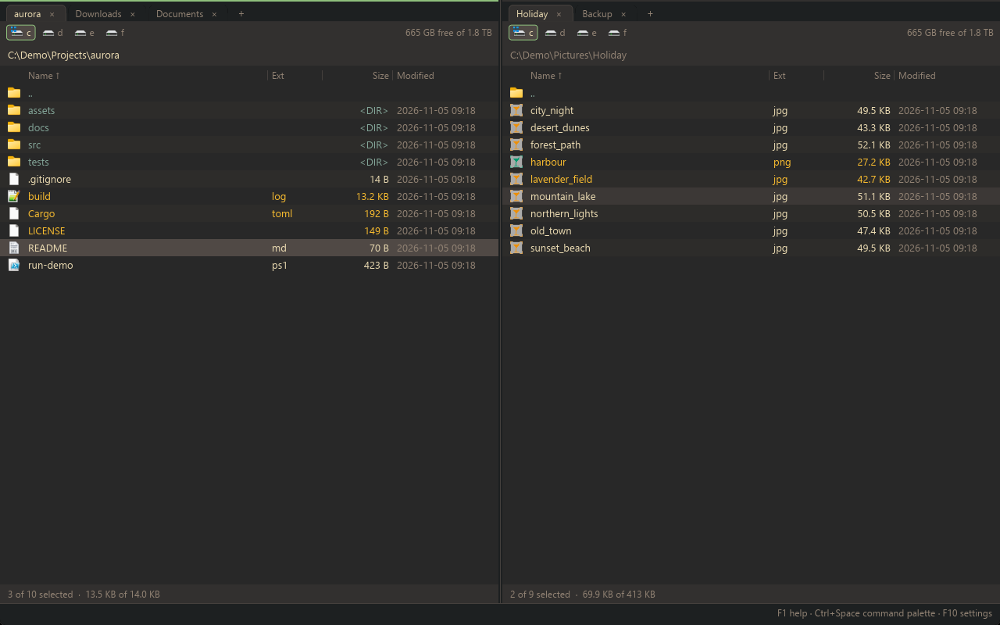

## Features

**Panels**
- Dual panels with tabs per side, virtualised lists, sorting, hidden-file toggle
- Thumbnail view per tab (Ctrl+Shift+F5): pictures, videos and documents as a grid of previews (Windows shell thumbnails), size set with `thumbnail_size`
- Quick search (just type), quick filter (Ctrl+S)
- Folder history (Alt+Left/Right, Alt+Down list) and a hotlist of favourite folders (Ctrl+D) with names and comments, optionally shown as a folder tree beside the panels (Ctrl+Shift+D)
- Folder sizes (Space on a folder), compare folders (Shift+F2)
- Folders are watched and refresh by themselves; tabs and folders are restored on start
- Drive bar with free space and the drive's name as a tooltip (middle-click opens a new tab, right-click the shell menu, updates when drives come and go), Enter on a disk image (.iso, .img, .vhd, .vhdx) mounts it and opens the new drive, path bar with autocomplete (expands %VAR% and ~)

**File operations**
- Copy, move, delete, recycle bin and new folder run as background jobs, several at once, with progress, speed, pause and cancel
- Overwrite prompts (overwrite, all, older, skip, skip all); symlinks and junctions are copied as links
- File clipboard: Ctrl+C / Ctrl+X / Ctrl+V copy, cut and paste files, also with Explorer
- Inline rename (F2) and multi-rename with masks and live preview (Ctrl+M)
- Find files (Ctrl+F) by name, mask or regex and by content, also inside archives and on servers
- Compare files side by side (Alt+F2)

**Viewer (F3)**
- Text, hex and image modes, find, word wrap, zoom and pan
- Streams huge files; mouse selection and copy
- Markdown files (.md) are shown rendered (key 5; 1 shows the source): headings, lists, task lists, tables, code blocks and quotes; find marks the matches in place, whole blocks can be selected and copied, links open in the browser or, for other .md files, in the viewer
- Enter on a .md file opens it in the viewer ("Markdown in the viewer" setting)

**Archives**
- Browse zip, 7z, rar (rar4/rar5, multi-volume, encrypted; read-only), tar, tar.gz, tar.bz2 and gz like folders; pack (Alt+F5) and unpack (Alt+F9)
- Add, change and delete files inside zip, 7z, tar and gz archives

**Remote (SFTP, FTP, FTPS)**
- Servers appear as folders (Ctrl+F7 connect, Ctrl+Shift+F disconnect); copy and move between your disk and a server, or between two servers
- Interrupted downloads and uploads can be resumed (Resume / Resume all in the overwrite prompt)
- Saved connections; passwords are kept in the Windows Credential Manager; SSH host keys are checked and remembered
- SFTP: key-file login (also passphrase-protected keys), free space in the drive bar, connects to old servers (SHA-1 key exchange and MACs, CBC ciphers as a last resort)
- FTP/FTPS: symlinks are listed and linked folders open like folders, idle connections are kept alive, a self-signed FTPS certificate can be trusted after asking (remembered like an SSH host key)

**Shell integration (Windows)**
- System icons and the Explorer context menu (right-click)
- Drag and drop between the panels and with other apps (both mouse buttons); a right-button drop asks Copy here / Move here (More options... shows Explorer's drop menu)
- F4 opens your editor; Ctrl+F9 opens an external terminal in the current folder (picked from the installed ones in F10)

**Built-in terminal (F9)**
- PowerShell 7 if installed, else Windows PowerShell (or any shell you set), in a ConPTY, started in the current folder
- Several terminals: a sidebar on the right switches between Files and the terminals; while the files are shown it collapses to a thin strip over the panels
- Mouse selection, copy/paste (bracketed paste), scrollback with a scrollbar; asks before quitting while terminals run
- Enter on a .ps1, .cmd or .bat file runs it in a new terminal in its folder ("Run scripts in terminal" setting); the context menu of a script also has Run in terminal and Run in external terminal
- A terminal you're not looking at gets a dot in the sidebar when a command finishes or its program waits for input (bell, OSC 777/9/99 notifications, OSC 9;4 progress cleared). opencode works as is; for Pi, either use its `notify.ts` extension or set `"terminal": { "showTerminalProgress": true }` in `~/.pi/agent/settings.json` (off by default)

**Configuration and keymap**
- `config.toml` with editor, terminal, built-in terminal shell, theme, key bindings and colours; changes apply on save
- F10 settings view (general, key bindings with a filter box, colours) that keeps your comments in the file
- F1 help, Ctrl+Space command palette, built-in themes (Gruvbox, the default, Dark, Light, Nord)
- Every action is a `cm_*` command, so any key can be bound to any command
- Check for updates (command palette): finds a newer release on GitHub, downloads the installer and updates in place; optionally at startup (`check_updates_at_startup`)
- Software rendering (`software_rendering`, F10, off by default so the GPU draws): draws with the CPU instead, so the window opens in about 0.1 s instead of 0.6 s, but scrolling and big folders are slower; the panels fill in as their folders are read

## Key bindings

| Key | Action |
|---|---|
| Tab | Switch panel |
| Enter / Backspace | Open / parent folder |
| Ctrl+\ | Go to root |
| Ctrl+T / Ctrl+W | New / close tab |
| Ctrl+Tab / Ctrl+Shift+Tab | Next / previous tab |
| Ctrl+Up | Open folder in a new tab |
| Space / Insert | Select (Insert moves down) |
| Ctrl+A / Esc | Select all / deselect |
| Ctrl+F3, F4, F5, F6 | Sort by name, extension, date, size |
| Ctrl+H | Show / hide hidden files |
| Ctrl+Shift+F5 | Thumbnail view on / off |
| Ctrl+S | Quick filter |
| Ctrl+C / Ctrl+X / Ctrl+V | Copy / cut / paste files (clipboard) |
| Ctrl+D / Ctrl+Shift+D | Hotlist / hotlist tree |
| Alt+Left / Alt+Right / Alt+Down | History back / forward / list |
| Alt+O | Show this folder in the other panel |
| F1 | Help |
| F2 / Shift+F6 | Rename |
| F3 / F4 / Shift+F4 | View / edit / edit new file |
| 1 / 3 / 5 (viewing a text file) | Text / hex / rendered Markdown |
| F5 / F6 | Copy / move to the other panel |
| F7 | New folder |
| F8 / Del | Delete to recycle bin |
| Shift+F8 / Shift+Del | Delete permanently |
| F9 / Ctrl+F9 | Built-in terminal / external terminal |
| Ctrl+Shift+F9 | Back from the built-in terminal to the panels (it keeps running) |
| Ctrl+Tab, Ctrl+Shift+Tab (in a terminal) | Next / previous terminal (Files is skipped); in the panels they switch panel tabs |
| Ctrl+Shift+T / Ctrl+Shift+Down, Up / Ctrl+Shift+W | New terminal / next, previous entry of the terminal sidebar / close the shown terminal |
| Ctrl+Shift+C, Ctrl+Shift+V / right-click (in the terminal) | Copy the mouse selection / paste (right-click copies the selection, else pastes); mouse wheel and Shift+PgUp/PgDn scroll the history |
| F10 | Settings |
| Shift+F2 | Compare folders |
| Alt+F2 | Compare files |
| Alt+F5 / Alt+F9 | Pack / unpack |
| Ctrl+F | Find files |
| Ctrl+M | Multi-rename |
| Ctrl+F7 / Ctrl+Shift+F | Connect to / disconnect from a server |
| Ctrl+Space | Command palette |
| Ctrl+, | Edit config.toml |
| Alt+F4 / Ctrl+Q | Quit |

## Screenshots

| | |
|---|---|
| 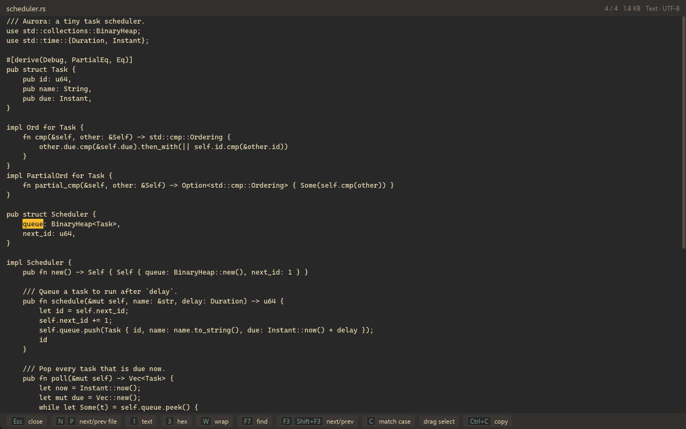 | 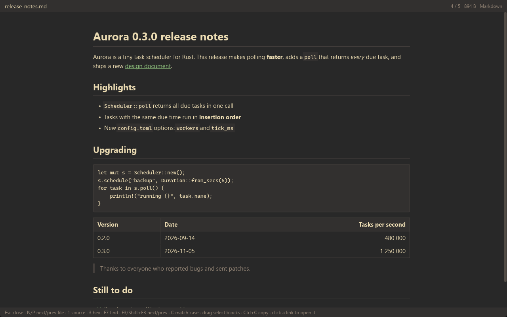 |
| 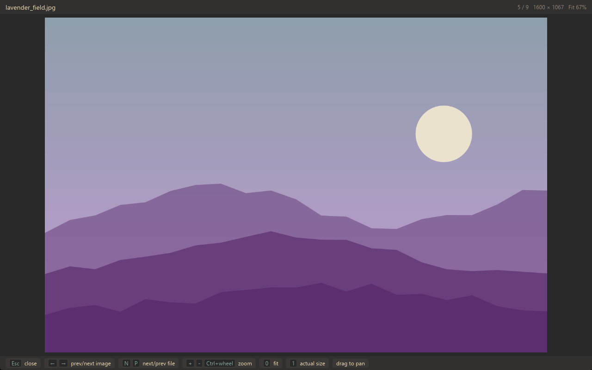 | 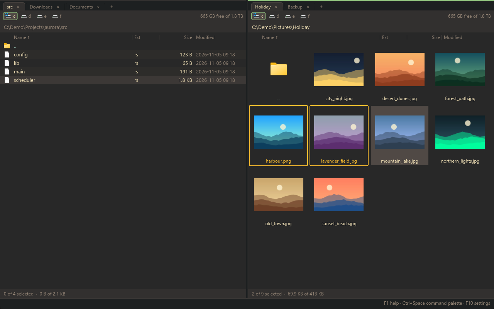 |
| 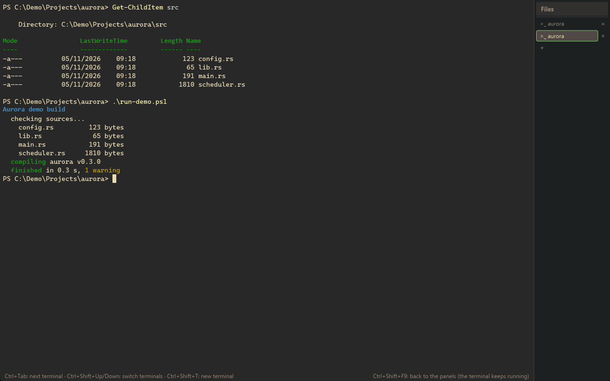 | 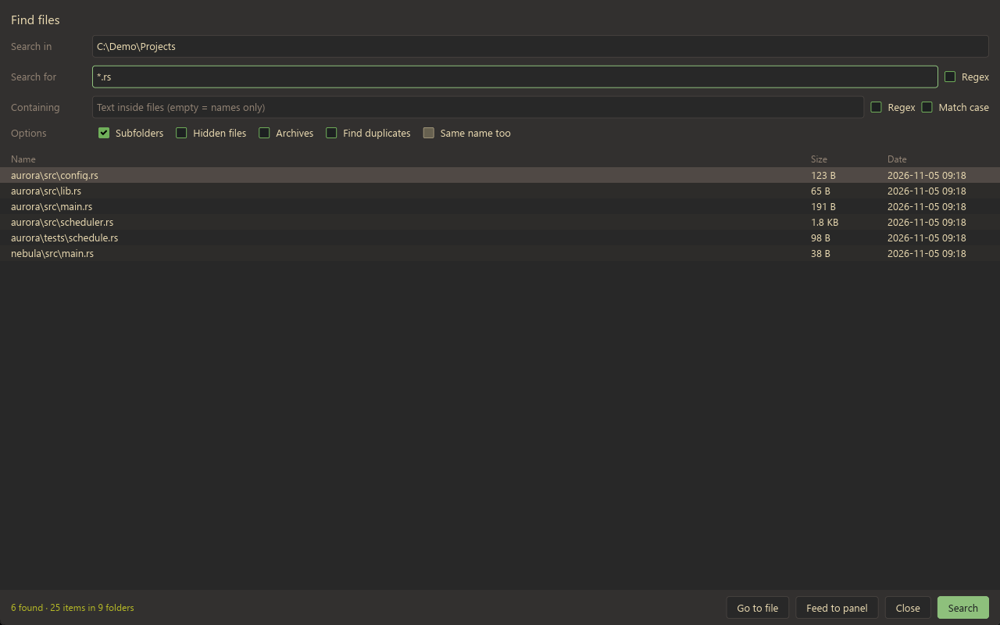 |
| 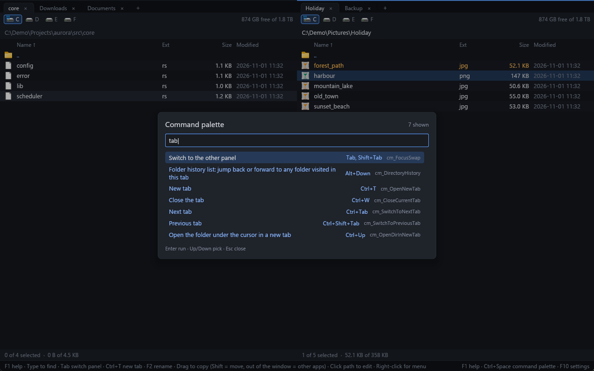 | 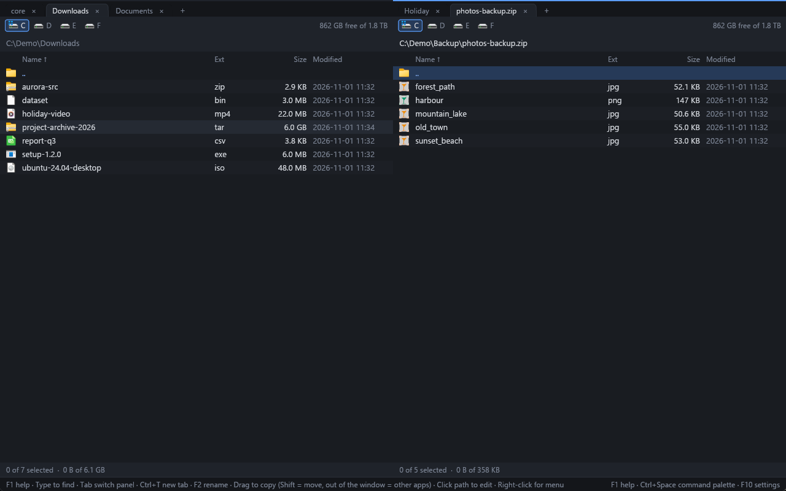 |
| 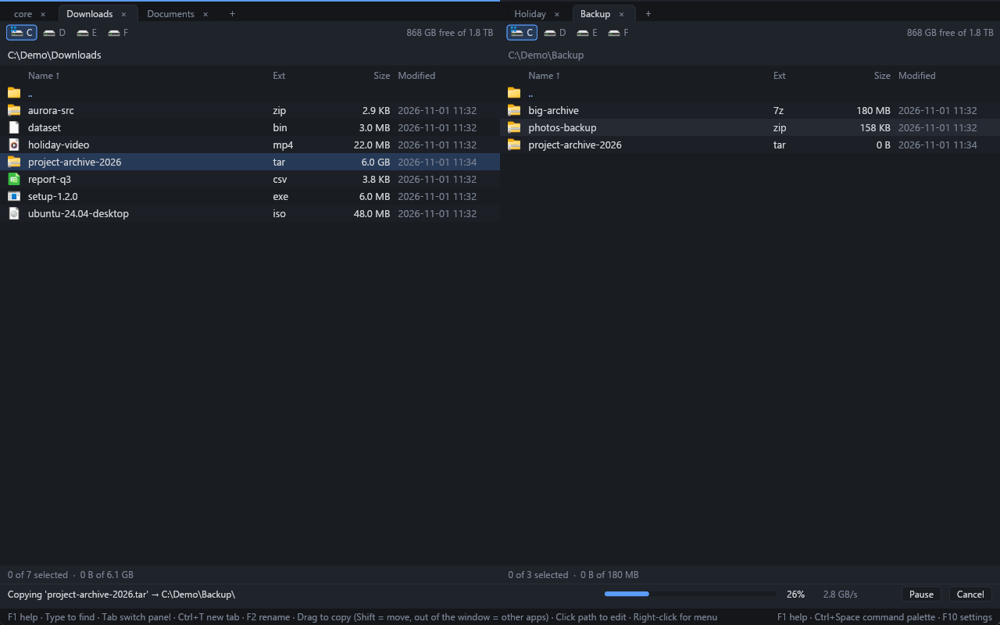 | 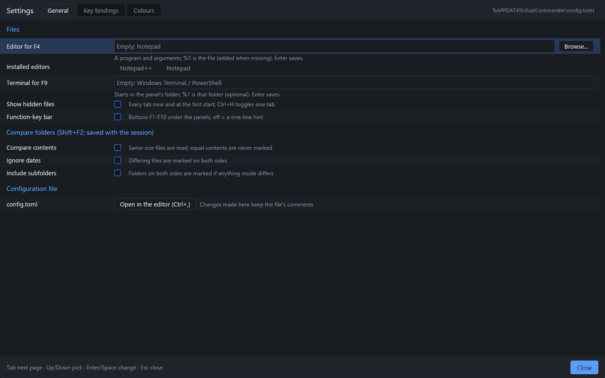 |
| 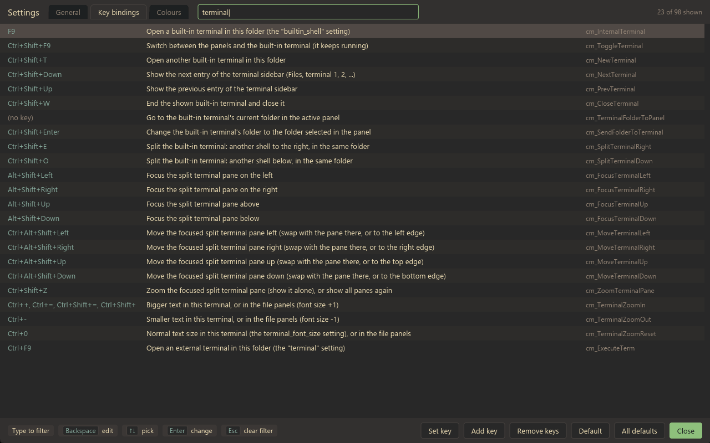 | 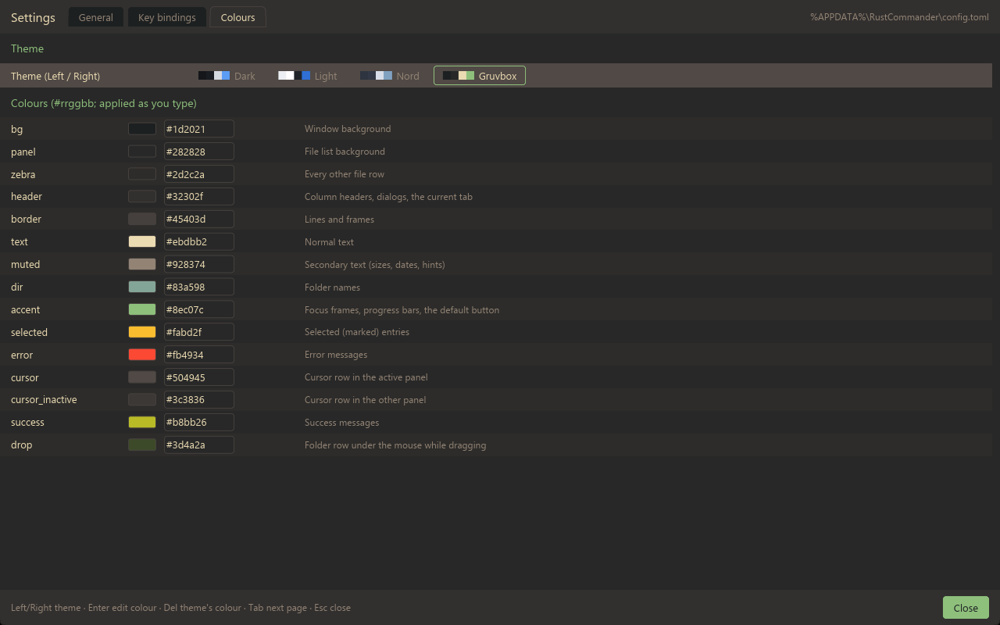 |

## Install and run

**Portable zip**: download `RustCommander-<version>-win64.zip` from the
[Releases](../../releases) page, unzip it anywhere and run `rustcommander.exe`.
No installer and no extra runtime are needed.

**Installer**: `RustCommander-<version>-setup.exe` (same Releases page) installs
to Program Files (or just for you), with a Start menu shortcut, an optional
desktop icon and an uninstaller. Your settings in `%APPDATA%\RustCommander`
are kept unless you choose to remove them.

**From source** (needs a Rust toolchain with the MSVC target):

```sh
powershell -File scripts\fetch-conpty.ps1  # once: Microsoft's ConPTY for the built-in terminal (optional)
cargo run -p rustcommander --release    # run
cargo build --release                   # build only
cargo test                              # tests
powershell -File scripts\package.ps1    # zip + installer (Inno Setup 6) in dist/
```

## Configuration

Settings live in `%APPDATA%\RustCommander\config.toml` (created with a
commented template on first run; Ctrl+, opens it, F10 edits it from the UI).
The open tabs are kept in `session.toml` and saved connections in
`connections.toml` in the same folder.

```toml
theme = "nord"            # gruvbox (default), dark, light or nord

[compare]                 # compare folders (Shift+F2), also Ctrl+Shift+F2 / F10
by_content = true

[keys]                    # "Key" = "command"; an empty command unbinds the key
"Ctrl+K" = "cm_MkDir"
"F8" = ""

[colors]                  # "#rrggbb", on top of the theme
accent = "#ff8800"
dir = "#8cb8ff"
```

Colour names: `bg`, `panel`, `zebra`, `header`, `border`, `text`, `muted`,
`dir`, `accent`, `selected`, `error`, `cursor`, `cursor_inactive`, `success`,
`drop`. The template lists every command id.

## Platform

Windows only for now (Windows 10/11, 64-bit). The core is UI-agnostic, but
shell integration and the build are Windows-specific.

## Project layout

| Crate | Purpose |
|---|---|
| `crates/core` | Panels, commands, file operation jobs, archives and servers as a virtual file system |
| `crates/platform` | OS integration: drives, icons, context menu, drag and drop |
| `crates/ui` | The iced front end, keymap and themes |

## License

MIT — see [LICENSE](LICENSE).

Third-party notice: RAR archives are read with RARLAB's UnRAR library,
compiled into the program (via the `unrar_sys` crate). UnRAR is freeware, not
open source: it may be used free of charge to handle RAR archives, but not to
build a RAR-compatible archiver or re-create the RAR compression algorithm.
Its full license is in [THIRD-PARTY-NOTICES.txt](THIRD-PARTY-NOTICES.txt),
which ships with the zip and the installer. The built-in terminal's font,
Microsoft's Cascadia Mono, is built in under the SIL Open Font License 1.1
(also in that file).
